# FarmaImport, C.A. — Sistema de Facturación Digital (simulación SENIAT)

Sistema web de punto de venta (POS), inventario y facturación digital para una
farmacia. Genera facturas con el formato exigido por el SENIAT **como
simulación académica, sin validez fiscal**.

> **Proyecto:** Sistema de Facturación Digital con Simulación SENIAT
> **Materia:** Diseño y Desarrollo Web — Proyecto Final (Versión 2)
> **Fecha:** Noviembre 2026

---

## Integrantes

| # | Nombre y apellido | Cédula | Módulo a su cargo |
|---|-------------------|--------|-------------------|
| 1 | Luis Molina       |        | Módulo 1 — Autenticación, roles y usuarios |
| 2 | Adrián Vásquez    |        | Módulo 2 — Productos e inventario |
| 3 | Wilmer Alejos     |        | Módulo 3 — Punto de venta y ventas |
| 4 | Piterson Alvarado |        | Módulo 4 — Facturación SENIAT y reportes |
| 5 | Anderson Pereira  |        | Base de datos, RLS, pruebas y despliegue |

---

## Enlaces

| Recurso | URL |
|---|---|
| **Aplicación en producción (Vercel)** | **https://farmaimport.vercel.app** |
| Repositorio en GitHub | https://github.com/luisemb17-netizen/farmaimport |
| Panel de Supabase | https://supabase.com/dashboard/project/iviulyirizuivsncbwsl |

> ✅ Entregar la URL de **producción** (`https://farmaimport.vercel.app`), no una de
> Preview: las Preview están protegidas y el profesor vería un login de Vercel.
>
> 🔑 Cuenta de demostración: `luisemb.17@gmail.com` · clave `unidad17*` (administrador).

---

## Stack

| Capa | Tecnología |
|---|---|
| Frontend | **Next.js 16** (App Router) + TypeScript |
| Estilos | **Tailwind CSS v4** (configurado en `globals.css`, sin `tailwind.config.ts`) |
| Base de datos | **Supabase (PostgreSQL)** con RLS |
| Autenticación | **Supabase Auth + `@supabase/ssr`** |
| Almacenamiento | **Supabase Storage** (bucket público `imagenes`) |
| PDF | `jspdf` + `jspdf-autotable` (importación dinámica) |
| Gráficos | `recharts` |
| Formularios | `react-hook-form` + `zod` |
| Notificaciones | `react-hot-toast` |
| Íconos | `lucide-react` |
| Despliegue | **Vercel** |

> **Nota sobre la versión:** `create-next-app@latest` instaló **Next.js 16**, así
> que el archivo que protege las rutas es **`src/proxy.ts`** (en Next 14/15 se
> llama `src/middleware.ts` y exporta `middleware`). Todas las APIs de request
> (`cookies`, `params`, `searchParams`) se usan con `await`, como exige Next 16.

---

## Capturas

Todas las capturas son del sistema **en producción** (`farmaimport.vercel.app`),
con datos reales.

| Panel de control | Panel en modo oscuro |
|---|---|
| 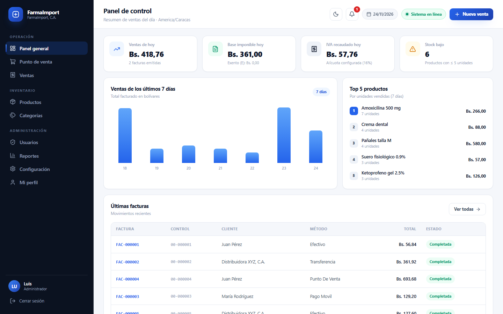 | 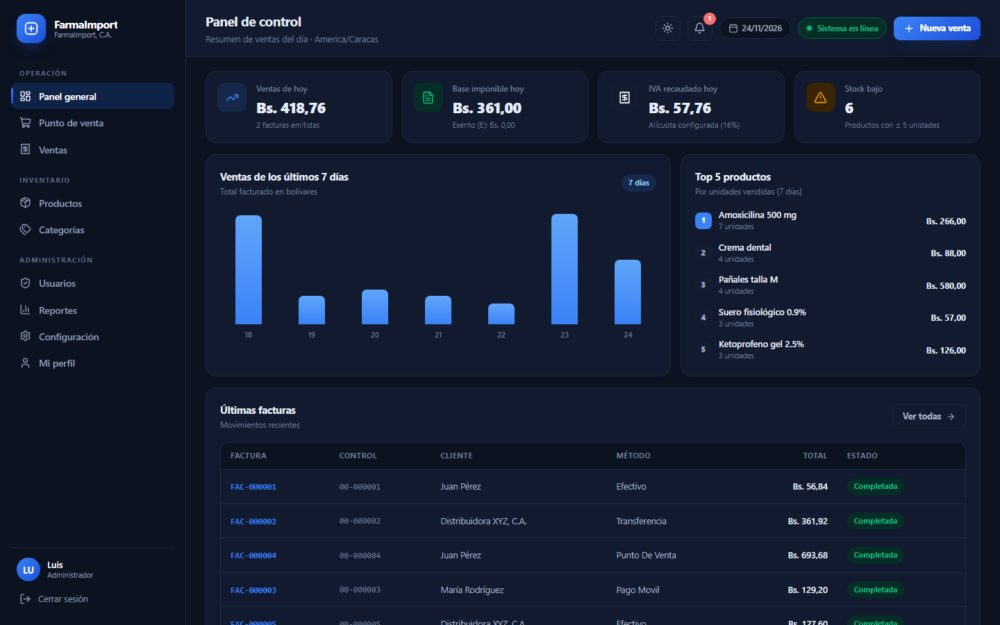 |

| Punto de venta | Factura SENIAT |
|---|---|
| 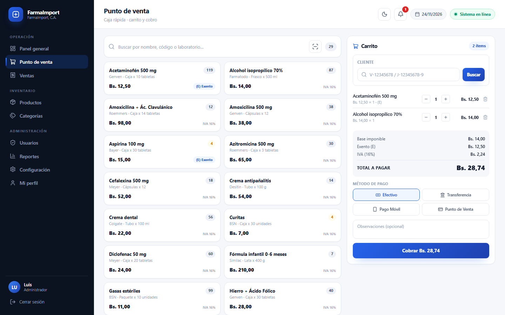 | 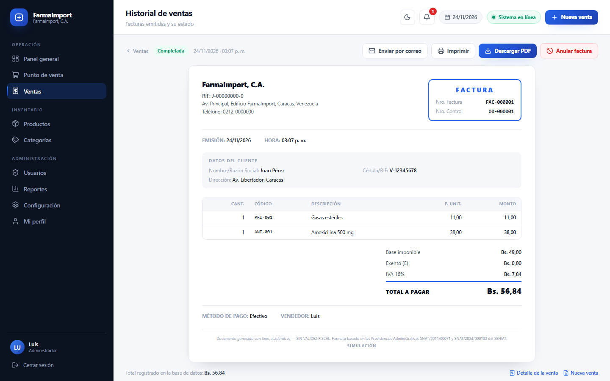 |

| Inventario | Usuarios |
|---|---|
| 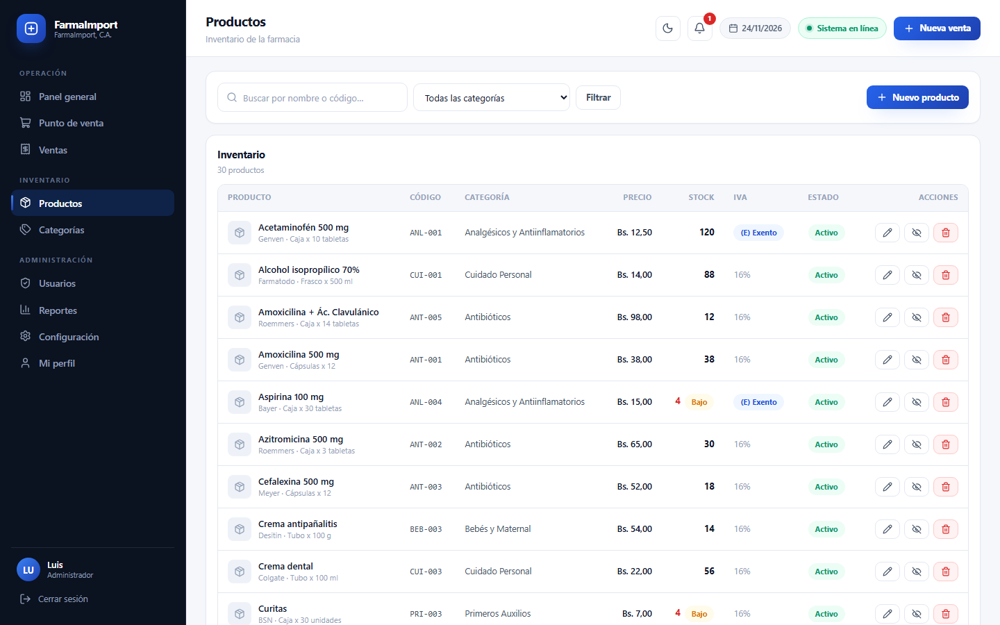 | 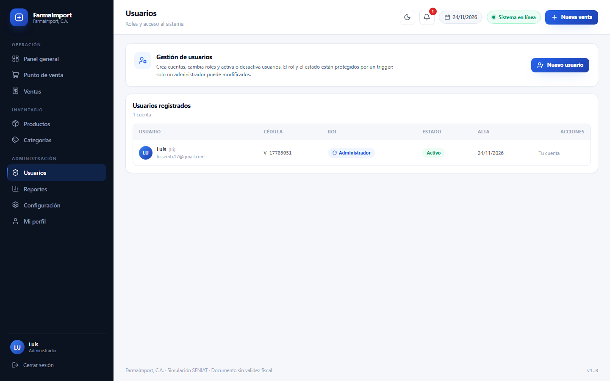 |

| Alta de usuario (solo admin) | Reportes |
|---|---|
| 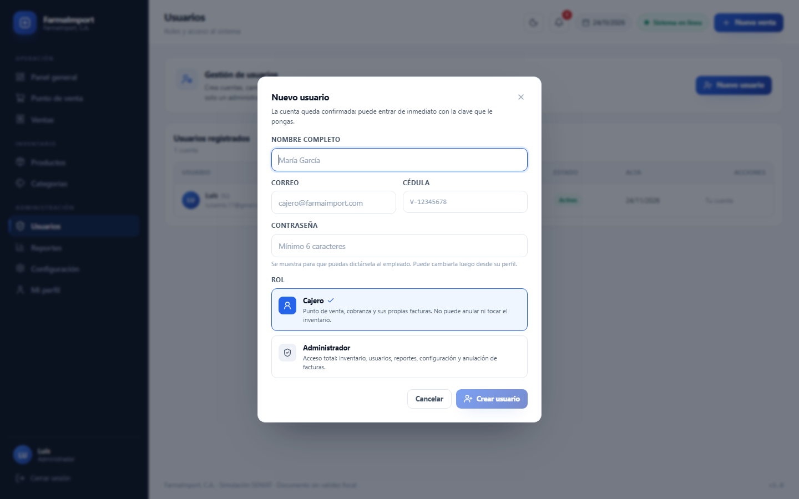 | 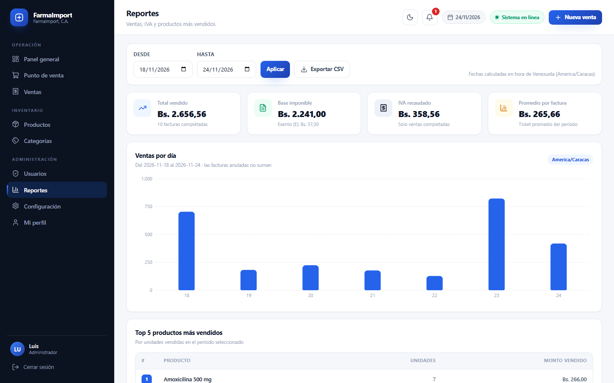 |

| Login | Registro |
|---|---|
| 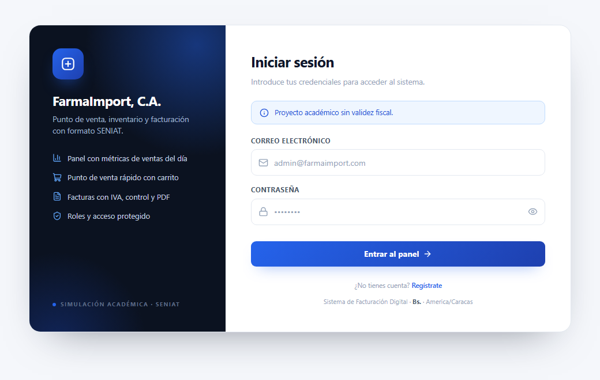 | 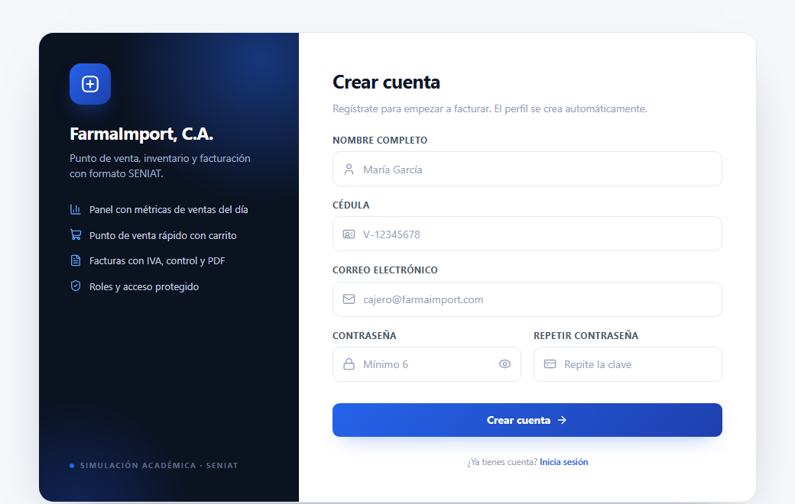 |

| Login en modo oscuro | Panel en móvil |
|---|---|
| 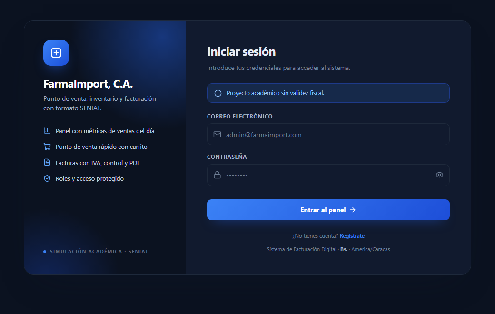 | 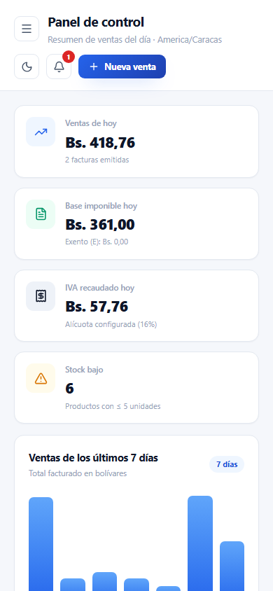 |

---

## Presentación del proyecto

| Archivo | Qué es |
|---|---|
| [`docs/Presentacion-FarmaImport.pdf`](docs/Presentacion-FarmaImport.pdf) | **18 diapositivas 16:9**: arquitectura, modelo entidad-relación, seguridad (RLS y triggers), alta de usuarios desde el panel, flujo de una venta, código de `registrar_venta()`, estructura, capturas reales de producción y puntos extra. |
| [`docs/presentacion.html`](docs/presentacion.html) | Fuente de la presentación (autocontenida). Se imprime a PDF con Chrome. |
| [`docs/Defensa-Base-de-Datos.pdf`](docs/Defensa-Base-de-Datos.pdf) | **15 diapositivas** centradas en la base de datos: cómo se construyó, llaves e índices, RLS, funciones SQL y el código en uso. |
| [`docs/GUION-DEFENSA.md`](docs/GUION-DEFENSA.md) | Guion oral: qué decir en cada diapositiva, 18 preguntas probables con su respuesta y una demo en vivo paso a paso. |

Los diagramas son SVG generados a medida (no son capturas): el entidad-relación
y el de secuencia de la venta se dibujan con código, así que se pueden editar.

Para regenerar el PDF después de cambiar algo:

```bash
# Windows: ruta típica de Chrome
"C:\Program Files\Google\Chrome\Application\chrome.exe" ^
  --headless=new --disable-gpu --no-pdf-header-footer ^
  --print-to-pdf="docs\Presentacion-FarmaImport.pdf" "docs\presentacion.html"
```

> Si cambias estilos dentro del HTML, recuerda que cada `.slide` mide 1280×720 px
> y que el `@page` está fijado a ese tamaño: es lo que mantiene el formato 16:9.

---

## Puesta en marcha (local)

> 📖 **Guía detallada, clic por clic:** [`docs/GUIA-SUPABASE.md`](docs/GUIA-SUPABASE.md).
> Resume los mismos pasos pero con capturas de dónde hacer clic y una tabla de
> errores frecuentes. Si es tu primera vez, sigue esa guía.

### 1. Requisitos

- Node.js **20.9+** (probado con Node 24)
- Una cuenta gratuita en [supabase.com](https://supabase.com)

### 2. Crear el proyecto en Supabase

1. Entra a **supabase.com** y crea un proyecto.
   - Región recomendada: **East US (North Virginia)**.
2. Guarda la contraseña de la base de datos fuera del repositorio.
3. En **SQL Editor**, ejecuta los archivos **en este orden**:

   | Orden | Archivo | Qué hace |
   |---|---|---|
   | 1 | `supabase/migrations/001_modulo1.sql` | `perfiles`, `configuracion_negocio`, triggers, `es_admin()`, RLS |
   | 2 | `supabase/migrations/002_modulo2.sql` | `categorias`, `productos`, bucket `imagenes` y sus políticas |
   | 3 | `supabase/migrations/003_modulo3.sql` | `clientes`, `ventas`, `detalle_ventas`, función `registrar_venta()` |
   | 4 | `supabase/migrations/004_modulo4.sql` | `anular_venta()`, vista `ventas_por_dia`, `top_productos()`, `resumen_periodo()` |
   | 5 | `supabase/seed.sql` | 6 categorías, 30 productos (con stock bajo) y 3 clientes |

4. En **Authentication → Sign In / Providers → Email**, desactiva
   **“Confirm email”** para la clase (o configura un SMTP propio).
5. En **Authentication → URL Configuration**:
   - **Site URL:** `https://tu-app.vercel.app`
   - **Redirect URLs:** `http://localhost:3000/**` y `https://tu-app.vercel.app/**`

### 3. Variables de entorno

Copia `.env.example` como `.env.local` y rellena los valores
(**Project Settings → API Keys**):

```bash
NEXT_PUBLIC_SUPABASE_URL=https://tu-proyecto.supabase.co
NEXT_PUBLIC_SUPABASE_PUBLISHABLE_KEY=sb_publishable_xxxxxxxxxxxx
```

> La *publishable key* es pública y la protege el RLS. **Nunca** pongas la
> `service_role` / secret key en una variable `NEXT_PUBLIC_`.

### 4. Correr la app

```bash
npm install
npm run dev      # http://localhost:3000
npm run build    # ejecútalo antes de cada push
```

> Si un cambio de estilos (`globals.css`) no se refleja, borra la carpeta `.next`
> y vuelve a arrancar: Turbopack a veces conserva el CSS en caché.

### 5. Crear la cuenta de administrador

El sistema **no trae usuarios ni contraseñas en el código**: las cuentas viven en
Supabase Auth (la clave se guarda hasheada, nunca en el repositorio).

Usa **tu correo real** como cuenta de administrador (así puedes recuperar la
clave si la olvidas).

**Opción A — desde la app (recomendada)**

1. Entra a `http://localhost:3000/registro` y crea la cuenta con tu correo.
2. Si «Confirm email» está activo, confirma el correo.
3. Abre `supabase/005_primer_admin.sql`, **cambia `TU-CORREO@ejemplo.com`** por
   tu correo y ejecútalo en el SQL Editor.

**Opción B — desde el panel de Supabase (más rápida para la defensa)**

1. **Authentication → Users → Add user → Create new user**.
2. Pon tu correo y una clave, y marca **Auto Confirm User**.
3. Ejecuta `supabase/005_primer_admin.sql` con tu correo.

Después entra a `/login` con esa cuenta: verás Usuarios, Reportes y Configuración.

> ⚠️ Es una cuenta de **demostración académica**. Cámbiale la clave después de la
> defensa y no la reutilices en ningún sistema real.

---

## Estructura del proyecto

```
farmaimport/
├── public/
├── supabase/
│   ├── migrations/
│   │   ├── 001_modulo1.sql
│   │   ├── 002_modulo2.sql
│   │   ├── 003_modulo3.sql
│   │   └── 004_modulo4.sql
│   ├── seed.sql
│   └── 005_primer_admin.sql
├── docs/capturas/                 # imágenes del README
├── src/
│   ├── proxy.ts                   # protege rutas (Next 16)
│   ├── app/
│   │   ├── layout.tsx             # <html>, fuente, <Toaster/>
│   │   ├── page.tsx               # redirige a /dashboard
│   │   ├── globals.css            # Tailwind v4 + tokens del tema
│   │   ├── (auth)/
│   │   │   ├── login/
│   │   │   └── registro/
│   │   └── dashboard/
│   │       ├── layout.tsx         # sidebar + topbar + sesión
│   │       ├── page.tsx           # panel de control
│   │       ├── productos/         # lista, nuevo, [id], [id]/editar
│   │       ├── categorias/
│   │       ├── pos/
│   │       ├── ventas/            # historial, [id], [id]/factura
│   │       ├── reportes/
│   │       ├── usuarios/
│   │       ├── configuracion/
│   │       └── perfil/
│   ├── components/
│   │   ├── ui/                    # Insignia, toasts
│   │   ├── layout/                # Sidebar, Topbar, DashboardShell
│   │   ├── auth/                  # MarcoAuth
│   │   ├── productos/             # FormularioProducto, AccionesProducto
│   │   ├── categorias/
│   │   ├── pos/                   # PuntoDeVenta, SelectorCliente
│   │   ├── facturas/              # PlantillaFactura, BotonPdf, BotonAnular
│   │   ├── reportes/              # GraficoVentas (recharts)
│   │   ├── usuarios/
│   │   ├── configuracion/
│   │   └── perfil/
│   └── lib/
│       ├── supabase/              # client.ts, server.ts, middleware.ts
│       ├── actions/               # Server Actions por módulo
│       ├── consultas/             # consultas compartidas de ventas
│       ├── validaciones/          # esquemas zod compartidos
│       ├── calculos.ts            # subtotal / exento / IVA / total
│       ├── formato.ts             # Bs., fechas en America/Caracas
│       ├── constants.ts
│       ├── imagen.ts              # conversión a WebP
│       ├── pdf/factura.ts
│       └── types/
├── .env.example
├── next.config.ts
└── README.md
```

---

## Los cuatro módulos

### Módulo 1 — Autenticación y usuarios

- Registro con metadatos (`nombre_completo`, `cedula`); un trigger en
  `auth.users` crea la fila en `perfiles`.
- Roles **administrador** y **cajero**; un trigger (`proteger_rol`) impide que un
  usuario no administrador cambie su rol o su estado.
- Protección de rutas en el servidor: `updateSession()` en `src/proxy.ts` +
  `supabase.auth.getUser()` en cada página.
- `es_admin()` con `SECURITY DEFINER` evita la recursión infinita del RLS.
- Configuración de una sola fila (`configuracion_negocio`) con RIF validado por
  expresión regular y secuencias de factura y control.

### Módulo 2 — Productos e inventario

- CRUD completo de productos y categorías, búsqueda y **paginación** (10 por página).
- Campos propios de farmacia: `laboratorio`, `presentacion` y `exento`.
- Indicador de **stock bajo** (≤ 5) y de producto agotado.
- Un producto con ventas **no se borra**: se desactiva (`activo = false`) y
  desaparece del POS (se captura el error `23503`).
- Imágenes en Supabase Storage con nombre único (`uuid.webp`), convertidas a
  WebP en el navegador; escritura solo para administradores.

### Módulo 3 — Punto de venta

- Caja rápida con buscador y carrito lateral.
- Búsqueda de cliente por cédula/RIF y alta en el momento.
- Cuatro métodos de pago: efectivo, transferencia, pago móvil y punto de venta.
- La venta se registra con la función SQL **`registrar_venta()`**, en una sola
  transacción:
  - `FOR UPDATE` sobre la configuración y cada producto,
  - números `FAC-000001` y `00-000001` seguros ante concurrencia,
  - validación de stock en tiempo real y descuento automático,
  - **snapshots** del cliente y de cada producto,
  - cálculo de totales en la base de datos con redondeo a 2 decimales.

### Módulo 4 — Facturación y reportes

- Factura con el formato de la simulación SENIAT: emisor, RIF, domicilio,
  números de factura y control, fecha y hora, comprador, detalle, base
  imponible, exento `(E)`, alícuota, IVA y total en **Bs.**
- Vista previa, **PDF** (`jsPDF` + `jspdf-autotable`, importado dinámicamente) e
  **impresión** directa (`window.print()` + `@media print`).
- **Anulación** solo para administradores, con motivo obligatorio: la factura
  pasa a `anulada`, guarda quién y cuándo, y devuelve el stock. Nunca se borra.
- Reportes (solo admin): ventas del día en `America/Caracas`, rango de fechas,
  gráfico con `recharts`, top 5 de productos y resumen de base imponible e IVA
  (sin contar las anuladas).

---

## Decisiones técnicas

| Tema | Decisión |
|---|---|
| Zona horaria | Todas las fechas se formatean con `timeZone: "America/Caracas"`. Venezuela es UTC−4 todo el año, así que la medianoche local es `T04:00:00Z`. |
| Moneda | Siempre **`Bs.`** (nunca `Bs.D`), con formato venezolano `1.234,56`. |
| Cálculo de IVA | Las líneas exentas no entran en la base imponible; el IVA se calcula sobre la base y se redondea a 2 decimales, igual en el carrito y en SQL. |
| Extensión al modelo | Se agregaron `productos.exento`, `productos.laboratorio`, `productos.presentacion`, `ventas.monto_exento` y `detalle_ventas.exento` para soportar la farmacia y los productos exentos que exige el formato de factura. |
| `cacheComponents` | Se desactivó el valor por defecto del scaffold: el panel usa datos por sesión y no necesita Cache Components. |
| Relación ambigua | `ventas` tiene dos FKs a `perfiles`, así que PostgREST necesita `vendedor:perfiles!ventas_vendedor_id_fkey(...)`. |

---

## Verificación rápida antes de entregar

- [ ] La URL de producción abre en incógnito y desde el celular.
- [ ] Registro → login → logout funcionan en producción.
- [ ] El cajero **no** puede entrar a `/dashboard/usuarios`, `/dashboard/reportes`
      ni `/dashboard/productos` escribiendo la URL.
- [ ] El cajero solo ve sus propias ventas.
- [ ] Una venta descuenta el stock y no permite vender más de lo disponible.
- [ ] La factura muestra los números correctos y descarga el PDF.
- [ ] Anular devuelve el stock y la factura sale de los totales.
- [ ] El RLS está activo en todas las tablas (Supabase → Advisors).
- [ ] No hay llaves en el repositorio (`sb_secret`, `service_role`, `eyJ`).
- [ ] Todos los integrantes tienen commits a su nombre.

---

## Puntos extra implementados (+13)

| Punto extra | Pts | Dónde está y cómo se prueba |
|---|---|---|
| 🌙 **Modo oscuro** | +2 | Botón sol/luna en la barra superior y en el login. Guarda la preferencia en `localStorage` (`farmaimport-tema`) y la aplica antes del primer pintado para que no parpadee. |
| 📊 **Exportar a CSV** | +2 | Botón «Exportar CSV» en **Reportes** y en **Ventas**. Ruta `GET /api/reportes/ventas` con BOM y separador `;` (Excel en español). Respeta el RLS. |
| 🔔 **Alerta de stock vacío** | +1 | Campana en la barra superior con el número de productos agotados; al cobrar avisa si un producto quedó en 0. |
| 📱 **PWA** | +2 | `src/app/manifest.ts`, íconos en `public/icons/` y `public/sw.js`. Instalable desde el navegador; el service worker solo cachea assets estáticos. |
| 📷 **Código de barras** | +3 | Icono de escáner en el POS: abre la cámara con `@zxing/browser` y agrega el producto al carrito (requiere HTTPS o localhost). |
| 📧 **Factura por email** | +3 | Botón «Enviar por correo» en la factura: genera el PDF en el servidor y lo adjunta con **Resend**. Requiere `RESEND_API_KEY`. |

### Cómo demostrarlos

1. **Modo oscuro** — pulsa la luna arriba a la derecha (o en el login) y recarga: se mantiene.
2. **CSV** — Reportes → «Exportar CSV», o Ventas → «Exportar CSV» con los filtros puestos.
3. **Stock vacío** — vende todas las unidades de un producto (por ejemplo `ANL-006`, que
   arranca en 0) y mira la campana.
4. **PWA** — en Chrome: menú ⋮ → «Instalar aplicación».
5. **Código de barras** — POS → icono de escáner. Sin cámara o sin HTTPS muestra un aviso.
6. **Email** — agrega `RESEND_API_KEY` (y opcionalmente `EMAIL_FROM`) en `.env.local`
   o en Vercel, y pulsa «Enviar por correo» en una factura.

> La llave de Resend es **secreta**: va sin `NEXT_PUBLIC_` y solo en el servidor.

---

## Aviso académico

Este sistema **no se conecta al SENIAT real** y sus facturas **no tienen validez
fiscal**. Replica el formato de las Providencias Administrativas
**SNAT/2011/00071** y **SNAT/2024/000102** únicamente con fines académicos.
